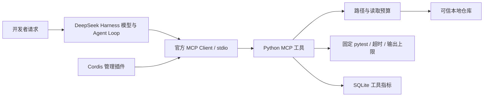

# CodeBridge · 代码仓库上下文与改动复核工具

[](https://github.com/solamn-1042/codebridge-mcp-demo/actions/workflows/verify.yml)

**让 Coding Agent 有依据地回答：代码在哪里、具体改了什么、固定检查是否通过。** CodeBridge 将仓库概览、代码搜索、按行读取、Git patch 和测试结果接入 MCP，为 DeepSeek Harness 提供可追溯的路径、行号与执行状态。

## 解决什么问题

接手陌生仓库时，只有目录概览和 Git 改动统计，无法解释实现细节；直接提供任意 Shell 又会把路径选择、命令拼接和异常处理交给模型。CodeBridge 将这段流程收敛成 7 个有边界的仓库工具，并提供 3 个插件管理入口。

| 操作 | 工具 | 返回的证据 |
|---|---|---|
| 建立项目背景 | `repo_overview` | README 摘要、清单、分支与顶层结构 |
| 定位实现 | `search_code` | 文件路径、行号与字面量匹配片段 |
| 阅读上下文 | `read_file` | 指定行区间、行号、下一段读取位置 |
| 理解改动 | `change_summary`、`git_diff` | 改动列表与 staged/unstaged/HEAD 模式的文件 patch |
| 验证改动 | `run_project_check` | 固定 pytest 的退出码、有限输出和超时状态 |
| 排查工具运行 | `tool_metrics` | 调用次数、耗时、错误类型，不存源码正文 |

示例请求：

> 查看仓库概览，搜索 change_summary 的实现，按行读取相关代码，再查看 server.py 的 Git patch。用文件路径和行号解释改动；需要验证时执行固定 test 检查。

## 如何协作



Python 实现业务工具与边界，TypeScript/Cordis 管理启停与重连。模型、Agent Loop、MCP 协议传输由 DSH 与官方 SDK 提供；本项目不重复实现宿主。

## 快速验证

Python 3.12，在仓库根目录运行：

```powershell
python -m venv .venv
.venv\Scripts\Activate.ps1
python -m pip install -r requirements.txt
python -m pytest -q
python eval/benchmark.py --rounds 20
```

这会运行真实 stdio 协议与临时 Git 仓库用例，无需模型密钥。单独 `python server.py` 会等待 MCP 客户端连接，不提供网页。

接入 DSH：Node 22.19+（22.x）或 24+，使用兼容的 DSH 宿主；执行 `npm run build`，在宿主 WebUI 添加本仓库绝对路径，启用插件。若宿主不在同级 `deepseek-harness`，设置 `CODEBRIDGE_DSH_ROOT`。详细步骤、仓库路径配置与其他 MCP Host 配置见 [安装运行手册](docs/USAGE.md)。

## 已验证的能力

| 验证 | 结果与统计口径 |
|---|---|
| Python 回归 | 27 项；工具、路径、Git、超时及真实协议 |
| Cordis/DSH 集成 | 10 项；安装、工具注册、启停、崩溃后重连 |
| 20 轮 stdio 正常调用 | 121/121，临时样例仓库，无模型参与 |
| 越界 / Schema 错误 | 各 20/20 被识别，随后 40/40 合法读取成功 |
| 搜索平均 / P95 | 70.73 / 78.70 ms，包含本地 IPC |
| diff 平均 / P95 | 68.66 / 73.48 ms，包含本地 IPC |

证据：[逐次评测数据](eval/tool_benchmark.json)、[验证环境与复现](docs/VALIDATION.md)、[设计与场景](docs/设计与场景说明.md)。这些是工具协议可靠性与延迟数据，不是模型完成任务的成功率，也没有据此推算开发效率提升。

## 运行边界与关键实现

- `repository_policy.py`：固定根目录，拒绝越界、绝对路径、ADS、设备名与链接；搜索和读取有范围及大小预算。
- `execution.py`：`test` 固定映射当前 Python 的 `pytest -q`，`shell=False`，120 秒超时，每个输出流最多返回 4000 字节；超时尝试清理进程树。
- `server.py` / `telemetry.py`：统一工具响应及 SQLite 调用元数据，审计失败不阻断读取。
- `plugins/codebridge-manager.ts`：`codebridge_status`、`codebridge_set_enabled`、`codebridge_restart`；状态是生命周期信息，重连后还需业务调用验证。

适用于可信本地仓库。pytest 会执行仓库代码；命令白名单不等于操作系统沙箱。默认 stdio，不提供公网远程执行、多租户或生产 SLA。云端 CI 验证 Windows/Linux Python 与协议；DSH 的 10 项集成结果来自本地兼容宿主验证。
